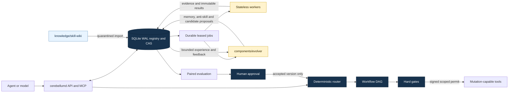

# Cerebellum monorepo architecture

This repository owns the complete Cerebellum system: the deterministic Rust
control plane, the Evolver proposal engine, the Skill Wiki corpus and the
replaceable workers. They share one commit and one CI pipeline, but they do not
share authority.



## Ownership and trust boundaries

| Path | Responsibility | Authority |
| --- | --- | --- |
| `crates/` | Registry, routing, workflows, permits, learning and API | Authoritative |
| `components/evolver/` | Memory, retrieval, consolidation and candidate export | Proposal only |
| `knowledge/skill-wiki/` | Wiki source pages and derived JSONL datasets | Quarantined input |
| `workers/` | Isolated optimization, acquisition and training adapters | Job-scoped output |
| `schemas/` | Versioned exchange contracts | Validated by Rust |
| `deploy/` | Container composition and gateway configuration | Operations |

Evolver cannot issue permits, promote a Skill, start training or mutate a
workflow. Its output returns through the Registry and must pass deterministic
validation, evaluation and any required human approval. Wiki content is data,
not executable instruction.

## Development entry points

Run the complete local quality gate on Windows:

```powershell
.\scripts\test-all.ps1
```

Run a narrower component loop when iterating:

```powershell
cargo test --workspace --all-targets

$env:PYTHONPATH = "components/evolver"
python -m pytest components/evolver/tests -q

python scripts/validate-monorepo.py
```

Install the Evolver CLI from this repository when its command is needed:

```powershell
python -m pip install -e .\components\evolver
```

The repository-wide CI runs Rust formatting, Clippy, Rust tests, JavaScript
syntax checks, worker tests, the Evolver suite and corpus validation.

## Import provenance

`IMPORT_MANIFEST.json` records each former repository, its source commit,
destination and excluded machine-generated state. The original local
repositories are intentionally retained outside this repository as rollback
copies. Future development, releases and deployment paths should use this
monorepo only.
